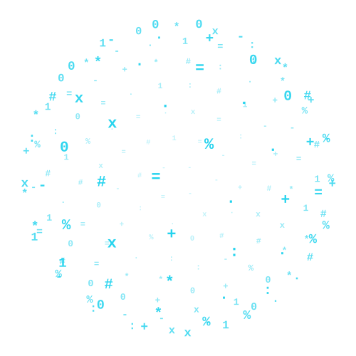

#  Bitshare

Secure, anonymous, and server-blind peer-to-peer (P2P) file sharing directly inside the browser.

## How it works (Zero-Knowledge)

1. **Local Encryption:** The file is encrypted with AES-GCM-256 inside your browser before transmission.
2. **Metadata in Hash:** The connection details (magnet URI, size, mime-type, and IV) and the decryption key are serialized directly into the sharing URL hash (`#`). 
3. **P2P Transfer:** The URL hash is never sent to the hosting server. The transfer takes place directly browser-to-browser (P2P) via WebRTC.
4. **No Server Storage:** There are no databases, no KV storage, and no cloud files. The host is blind to what is being shared.

## Setup & Dev

### Prerequisites
- Node.js (v18+)

### Development
1. Install dependencies:
   ```bash
   npm install
   ```
2. Build the static pages:
   ```bash
   npm run build
   ```
3. Test locally using Wrangler (or any static server):
   ```bash
   npx wrangler pages dev ./dist
   ```

## Deployment (Cloudflare Pages)

Since the app is 100% static, you can deploy it directly to **Cloudflare Pages** (or any static hosting like GitHub Pages, Vercel, Netlify):

1. Connect your repository to Cloudflare Pages.
2. Set the build command to `npm run build`.
3. Set the output directory to `dist`.
4. Deploy.

## License

MIT-INLED
